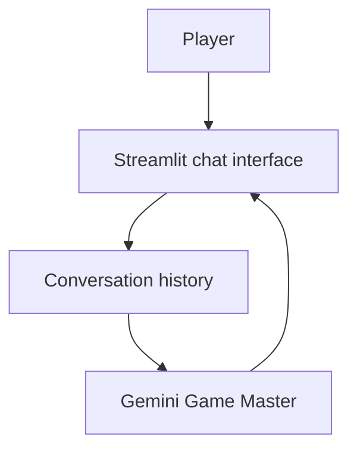
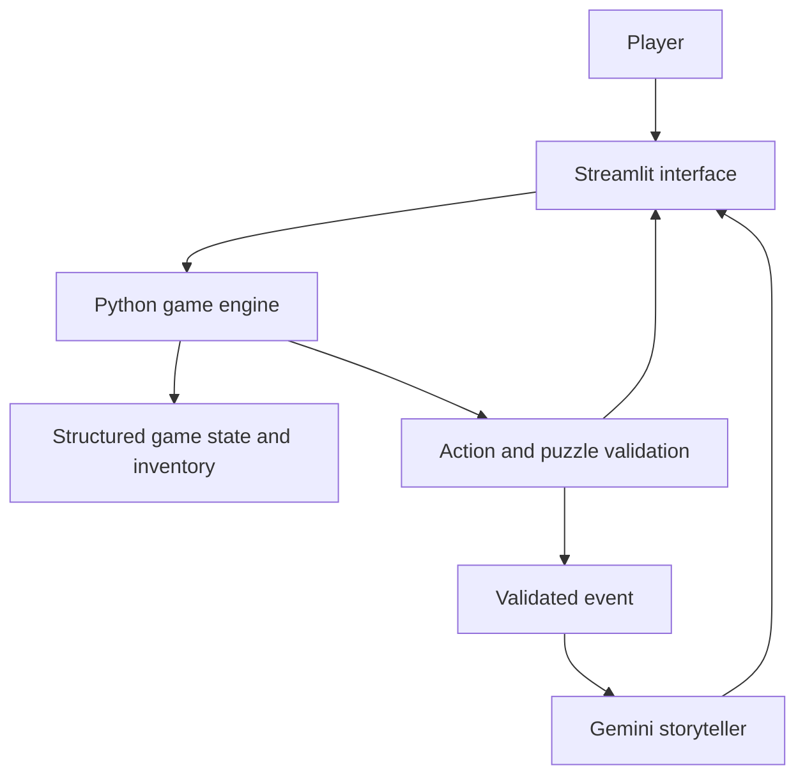

# AI Escape Room — Mystery Library

An interactive Python escape-room game built with Streamlit and Google Gemini. This coursework project contains two versions to demonstrate the improvement from an LLM-led prototype to a Python-validated game engine.

## Project versions

### Version 1 — Interactive AI Escape Room
- Streamlit chat interface.
- Gemini acts as the Game Master.
- The player investigates a desk, bookshelf and painting, opens a locked drawer and escapes through the exit.
- Game progress is primarily maintained through the conversation sent to the LLM.
- Limitation: the LLM may forget state, invent outcomes or be persuaded to bypass puzzle rules.

### Version 2 — Reliable AI Escape Room
- Python stores structured game state and inventory.
- Python validates clue prerequisites, drawer combination and exit code.
- Invalid actions, incorrect codes, administrator impersonation and requests for secret codes are rejected by the Python game engine.
- Gemini only narrates events that Python has already validated. If the API is unavailable, trusted Python messages are displayed instead.

## Room solution (for project documentation/testing)
- Desk: order is Sun, Moon, Star, Crown.
- Bookshelf: Sun = 4, Moon = 2.
- Painting: Star = 1, Crown = 7.
- Drawer combination: 4217.
- Exit code: 1935.

Do not reveal the solution in a player-facing demo before the player discovers it.

## Requirements
- Python 3.10 or newer
- Streamlit
- Google GenAI Python SDK
- python-dotenv
- A Google AI Studio Gemini API key (optional for Version 2 fallback; required for AI narration)

## Installation

1. Create and activate a virtual environment.
2. Install dependencies:

   ```bash
   pip install -r requirements.txt
   ```

3. Copy `.env.example` to `.env`.
4. Add your own Gemini API key to `.env`:

   ```env
   GEMINI_API_KEY=your_actual_key
   GEMINI_MODEL=gemini-2.5-flash
   ```

5. Never commit `.env`. It is excluded by `.gitignore`.

## Run Version 1

From the project root:

```bash
streamlit run version1/app.py
```

## Run Version 2

From the project root:

```bash
streamlit run version2/app.py
```

## Run automated tests

From the project root:

```bash
python -m unittest discover -s tests -v
```

The tests exercise the Python game logic without requiring a Gemini API key.

## Architecture

### Version 1



### Version 2



## Test cases

See [test_cases.md](test_cases.md). The automated tests are in `tests/test_game_logic.py`.

## Suggested repository structure

```text
AI-Escape-Room/
├── version1/
│   └── app.py
├── version2/
│   ├── app.py
│   └── game_logic.py
├── tests/
│   └── test_game_logic.py
├── requirements.txt
├── .env.example
├── .gitignore
├── test_cases.md
└── README.md
```

Add your own screenshots and demo video in a `screenshots/` folder before submission. Avoid committing API keys, virtual environments, temporary files or large unrelated datasets.

## Limitations

- Natural-language action parsing uses simple keyword matching and is a prototype, not a general-purpose language understanding system.
- The prompt-based Version 1 is intentionally less reliable than Version 2.
- Version 2 uses Python as the authority for game state; Gemini is only a narrative layer. A generated narration should not be treated as proof that game state changed.
